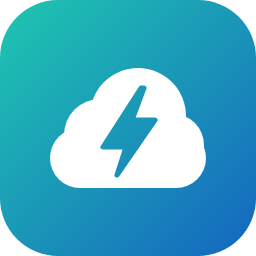

# HomeWizard Cloud for Home Assistant

**Unofficial Home Assistant integration for HomeWizard P1 meters through the
HomeWizard cloud, for meters outside your Home Assistant network.**

[](https://hacs.xyz/docs/faq/custom_repositories)
[](https://github.com/Emacee/HomeWizard-Cloud---HACS/actions/workflows/validate.yml)
[](https://github.com/Emacee/HomeWizard-Cloud---HACS/actions/workflows/tests.yml)

Custom integration that reads a **HomeWizard Wi-Fi P1 meter through the HomeWizard
cloud**. It is meant for a P1 meter that is *not* on the same network as Home
Assistant, such as a second home, a relative's house, a boat or an office, where the
local API can't be reached.

If the meter *is* on the same network, use the official
[HomeWizard Energy integration](https://www.home-assistant.io/integrations/homewizard/)
instead. It is local, officially supported and faster.

> [!WARNING]
> **Unofficial API.** HomeWizard does not publish a cloud API. This integration uses
> the same WebSockets as the HomeWizard Energy app and identifies itself as the Android
> app. The protocol was worked out by
> [Sven Serlier](https://github.com/smarthomesven/homey-homewizard-energy-cloud) and
> later implemented in [jtebbens/com.homewizard](https://github.com/jtebbens/com.homewizard)
> and [MauroDruwel/homewizard-cloud](https://github.com/MauroDruwel/homewizard-cloud).
> HomeWizard can change or block it at any time, and it is not covered by their
> support. Don't build control loops on it that must keep working when the cloud is
> unavailable.

## Compatibility

### HomeWizard products

| Product | Model | Status | Notes |
|---|---|---|---|
| **Wi-Fi P1 Meter** | HWE-P1 | ✅ Supported | Full state (power, voltage, current, energy per tariff, peak demand) plus the optional realtime power stream. Works with any firmware, because the local API (v1 or v2) is not used and does not need to be enabled. |
| Gas, water and heat meters read *through* the P1 meter | M-Bus meters connected to the smart meter | ✅ Supported | Appear as extra sensors on the P1 device (`external[]` in the cloud state). |
| Energy Socket | HWE-SKT | ❌ Not supported | The cloud stream knows this device type, but the integration only lists P1 meters. Switching a socket would need write commands, which this integration does not implement. |
| Watermeter | HWE-WTR | ❌ Not supported | On battery power it reports to the cloud only a few times a day. See [pyrech/homewizard_cloud_watermeter](https://github.com/pyrech/homewizard_cloud_watermeter). |
| kWh Meter (1-phase / 3-phase) | HWE-KWH1, HWE-KWH3, SDM230-wifi, SDM630-wifi | ❌ Not supported | Not implemented. |
| Plug-In Battery | HWE-BAT | ❌ Not supported | Not implemented. |
| Energy Display | HWE-DSP | ➖ Not applicable | Shows data from other devices and measures nothing itself. |
| Legacy HomeWizard (Wi-Fi Link, HomeWizard Lite) | — | ❌ Not supported | Different platform and cloud. |

Support for other devices may come later. Diagnostics from the real cloud for such a
device (see [Diagnostics](#diagnostics)) are the most useful starting point.

> [!NOTE]
> Version 0.1.x has been tested against a simulated cloud only. Real-world reports,
> especially for three-phase meters, DSMR 4 vs 5 and Belgian meters, are welcome.

### Cloud or local?

| Situation | Use |
|---|---|
| The P1 meter is on the same network as Home Assistant | The official [HomeWizard Energy](https://www.home-assistant.io/integrations/homewizard/) integration (local, supported, fastest) |
| The P1 meter is on another network (second home, relative, boat, office) | **This integration** |
| You want both, e.g. local at home plus cloud elsewhere | Both. They use different domains and don't conflict. |

### Home Assistant

- Home Assistant **2025.2** or newer.
- The bundled icon shows from **2026.3** (local brand images). Older versions show a
  placeholder icon, and everything else works the same.

## Installation

### HACS (recommended)

1. In HACS, open **⋮ → Custom repositories**.
2. Add `https://github.com/Emacee/HomeWizard-Cloud---HACS` with category **Integration**.
3. Search for **HomeWizard Cloud**, download it, and restart Home Assistant.
4. Go to **Settings → Devices & services → Add integration → HomeWizard Cloud**.

### Manual

Copy `custom_components/homewizard_cloud` to `/config/custom_components/` so that
`/config/custom_components/homewizard_cloud/manifest.json` exists, then restart Home
Assistant.

No extra Python packages are needed, because everything runs through Home
Assistant's own aiohttp session.

## Setup

1. Log in with the e-mail address and password of your HomeWizard Energy account.
2. If the account has more than one P1 meter, pick one. To add the others, add the
   integration again: each P1 meter is its own config entry.

If the cloud stops accepting the login, Home Assistant shows a re-authentication
prompt.

### Options (**Configure**)

| Option | Default | Meaning |
|---|---|---|
| Realtime power stream | on | A second WebSocket with second-by-second power. |
| Realtime power per phase | on | Also requests L1–L3 from the realtime stream. |
| Minimum time between updates | 5 s | Home Assistant writes new values at most this often (1–60 s). Lower values put more load on the recorder. |

## Entities

Each sensor appears as soon as its field shows up in the cloud state, so what you get
depends on the smart meter (single or three phase, gas, DSMR version).

| Entity | Source field | Notes |
|---|---|---|
| Power, Power phase 1–3 | `active_power_w`, `active_power_l1..3_w` | Positive = import, negative = export |
| Voltage (phase 1–3), Current (phase 1–3) | `active_voltage_*`, `active_current_*` | |
| Energy import / export | `total_power_import_kwh`, otherwise the sum of T1–T4 | Works with the Energy dashboard |
| Energy import/export tariff 1–4 | `total_power_*_t1..t4_kwh` | T3/T4 disabled by default |
| Tariff | `active_tariff` | |
| Average demand, Peak demand current month (+ timestamp) | `active_power_average_w`, `montly_power_peak_*` | Belgian capacity tariff |
| Gas / Water / Heat | `external[]` (M-Bus) | Falls back to `total_gas_m3` when no external gas meter is reported |
| Frequency, voltage sags/swells, power failures, Wi-Fi strength | various | Diagnostic, disabled by default |
| DSMR version, Smart meter model | `smr_version`, `meter_model` | Diagnostic |
| Power (realtime), Power phase 1–3 (realtime) | realtime stream | Only with the realtime option |
| Cloud connection, P1 meter online | connection state, `online` | Binary sensors |

When the cloud reports the meter as offline (`online: false`), the state sensors
become *unavailable*.

## How it works

1. **Login:** HTTP Basic auth with the account credentials on
   `api.homewizardeasyonline.com` returns an access token. The integration renews it
   5 minutes before it expires.
2. **Device list:** `homes.api.homewizard.com/locations` lists the homes and P1 meters
   of the account.
3. **State stream** (`wss://energy-app-ws.homewizard.com/ws/`): the integration sends
   `hello` with the token, then `subscribe_device`. The cloud first sends the full
   state, using the same field names as local API v1, followed by `json_patch` deltas.
4. **Realtime stream** (`wss://tsdb-reader.homewizard.com/devices/date/now`, optional):
   power every second, per phase when `three_phases` is set.

Both streams reconnect automatically with an increasing delay (10 s up to 5 min).
After 120 s without data the integration resubscribes. If nothing arrives within
another 30 s, it reconnects. Sensors stay available for 3 minutes during a reconnect,
so short hiccups don't leave gaps.

## Diagnostics

**Device → ⋮ → Download diagnostics** gives the full last cloud message. E-mail,
password, token, device id, serials and Wi-Fi SSID are redacted. Because the API is
undocumented, this is the way to see which fields your meter sends through the cloud.
Please attach it to issues.

Debug logging:

```yaml
logger:
  logs:
    custom_components.homewizard_cloud: debug
```

## Development

The protocol logic in `protocol.py` has no Home Assistant imports:

```bash
pip install pytest
pytest tests/test_homewizard_cloud.py
```

The config flow, sensors, re-auth, options and diagnostics are tested with the Home
Assistant test harness. So is the client, against a local fake cloud (an aiohttp
server):

```bash
pip install -r requirements_test.txt
pytest tests
```

The Home Assistant tests skip themselves when the harness is not installed.

## Artwork and trademarks

The icon (`assets/icon.svg`, rendered into `custom_components/homewizard_cloud/brand/`)
is original artwork made for this project. It is not a HomeWizard logo.
"HomeWizard" is a trademark of HomeWizard B.V. and is used here only to describe which
products this integration works with. This project is not affiliated with or endorsed
by HomeWizard.
